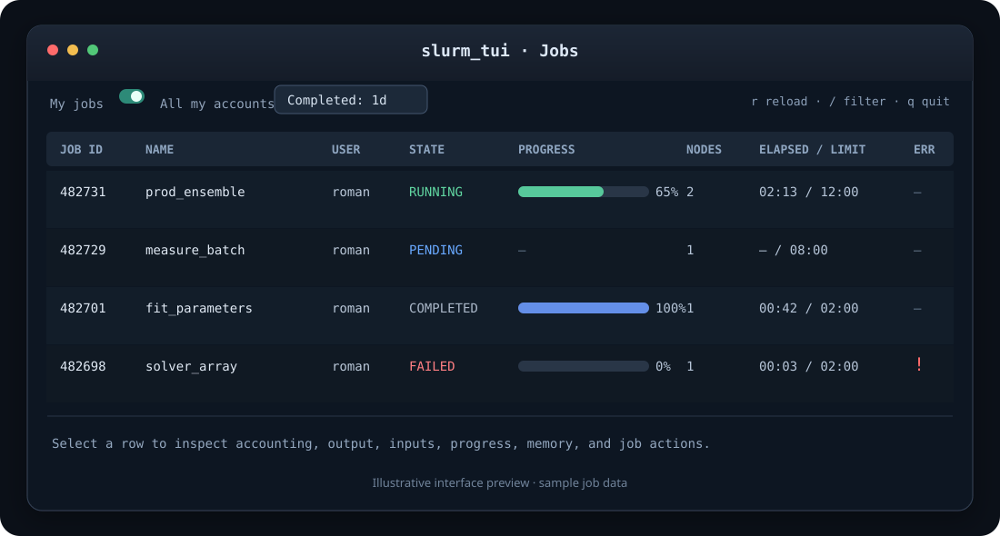

<p align="center"></p>

# slurp

`slurp` is a Textual interface for checking Slurm jobs and inspecting the files
and resources associated with them: queued, running and finished jobs, their
output and scripts, the nodes they run on, checks of batch scripts against a
rule catalogue, and shells and drives on the cluster. Use it in a terminal or
in a browser.



## Quick start

```bash
git clone https://github.com/chaoos/slurp.git
cd slurp
python3 -m venv .venv
source .venv/bin/activate
python -m pip install ".[all]"   # or just "." without the optional features
slurp                            # or: python -m slurp
```

Without cloning: `pipx install "slurp[all] @ git+https://github.com/chaoos/slurp"`.
Run it on a login node with Slurm, or on your own machine with an SSH
connection to one: `slurp --ssh user@cluster-login`.

## Documentation

The manual is [docs/manual.md](docs/manual.md). In the app, the `?` buttons
explain each window and `F1` opens the guides (job scripts, arrays, filesystems,
GPUs, ...). What changed between versions is in
[CHANGELOG.md](CHANGELOG.md).

## Layout

```
src/slurp/            the package (installed with pip; `slurp` is slurp.cli:main)
  cli.py launch.py      the command line, how slurp starts itself again
  config.py state.py    settings kept between runs; logging and the data of the tabs
  cluster/              Slurm here or over SSH: the connection, jobs, their files, storage, categories
  checks/               the checks of batch scripts: engine, rules, site rule packs (packs/*.toml), fixes, guides
  links/                shells, drives and web views on your own machine, the session holder, sshfs (windows/: the helper)
  ui/                   the Textual app, its widgets, terminals and logo; screens/: the windows
  scripts/              shell scripts slurp runs on the nodes of a job
tests/                pytest: unit/ (no app), ui/ (Textual windows), e2e/ (slurp against lab/: a fake Slurm behind a local sshd)
docs/                 the manual and its images
tools/                maintenance scripts (the logo files)
```

## Tests

```bash
python -m pip install -e ".[all,dev]"
python -m pytest tests/unit tests/ui   # seconds: nothing needed beyond pip
python -m pytest tests/e2e             # slurp against a fake Slurm over SSH (~10 min)
python -m pytest                       # all of them
pre-commit run --all-files             # the lint (ruff) and file checks; pre-commit install: before each commit
```

- `tests/unit/`: no app, no cluster. `tests/ui/`: windows of the Textual app,
  no cluster.
- `tests/e2e/` (Python 3.12+): slurp against the lab (`tests/e2e/lab/`), its own `sshd` on a
  free port of 127.0.0.1 with a fake Slurm and fresh keys, in pytest's
  temporary directory. It needs OpenSSH (`ssh`, `sshd`, `ssh-keygen`) and
  `sshfs` (Debian/Ubuntu: `apt install openssh-server sshfs`); without `sshd`
  these tests are skipped. They never touch your `~/.ssh` or slurp's
  settings.
  - The UI tests (`test_ui_*.py`, the scenarios in `ui_scenarios.py`) run in a
    logged-in app per module.
  - Logs and screenshots go to `<basetemp>/lab0/out/` (`--basetemp=DIR` sets
    the place).
  - One test: `python -m pytest tests/e2e/test_ui_arrays.py -k collapse`.
- The tests use the installed slurp and stop if it is not this checkout's
  (another checkout or worktree: install that one, or `PYTHONPATH=src`).
  See [tests/conftest.py](tests/conftest.py) and
  [tests/e2e/conftest.py](tests/e2e/conftest.py).

The same runs on GitHub Actions ([.github/workflows/tests.yml](.github/workflows/tests.yml)):
the unit tests on Python 3.11 to 3.13, the lab on 3.12.

## License

GPL-3.0, see [LICENSE](LICENSE).
