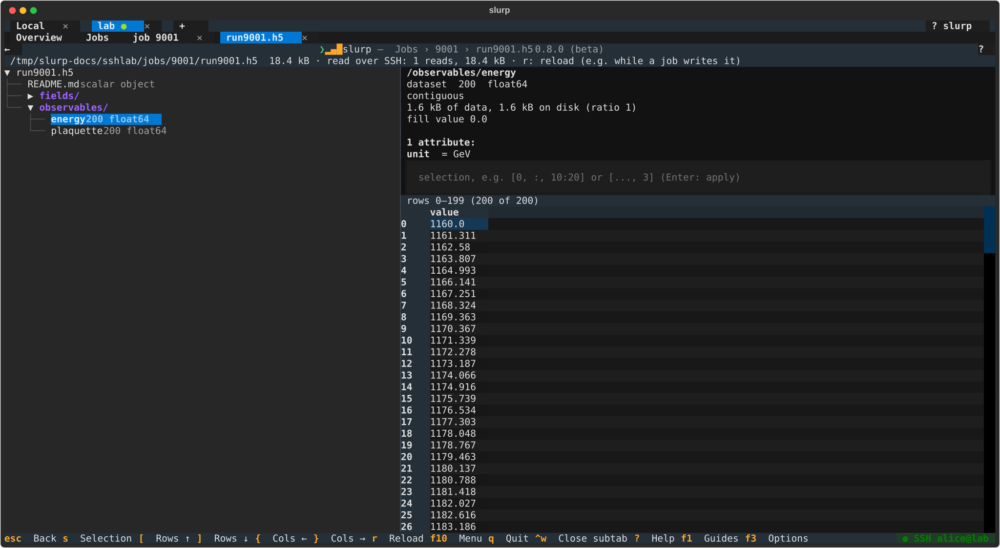

# Files and node tools

The file browser opens from the job details and lets you move through the
working directory and related paths. It includes specialized views:

- **Markdown:** `.md`, `.markdown`, `.mdown`, and `.mdx` files render with
  Textual's `MarkdownViewer`, including a table of contents and link navigation.
- **HDF5:** browse groups, datasets, attributes, and paged data; a string
  dataset named `*.md` is rendered as Markdown. HDF5 files
  are recognized by their file signature, including files without an `.h5`
  extension.
- **Core dumps:** inspect ELF core metadata with GDB and edit the suggested GDB
  command before launching it in the terminal pane. Core-to-job association
  uses node and timestamp clues and is marked as likely/possible.
- **Text and output:** follow running stdout/stderr, search text, and open
  paths or line references found in file contents.

For a running job, run commands such as `nvidia-smi`, `free`, `top`, or `ps`
on its allocated nodes. Shells on its node and GDB sessions open as subtabs.

