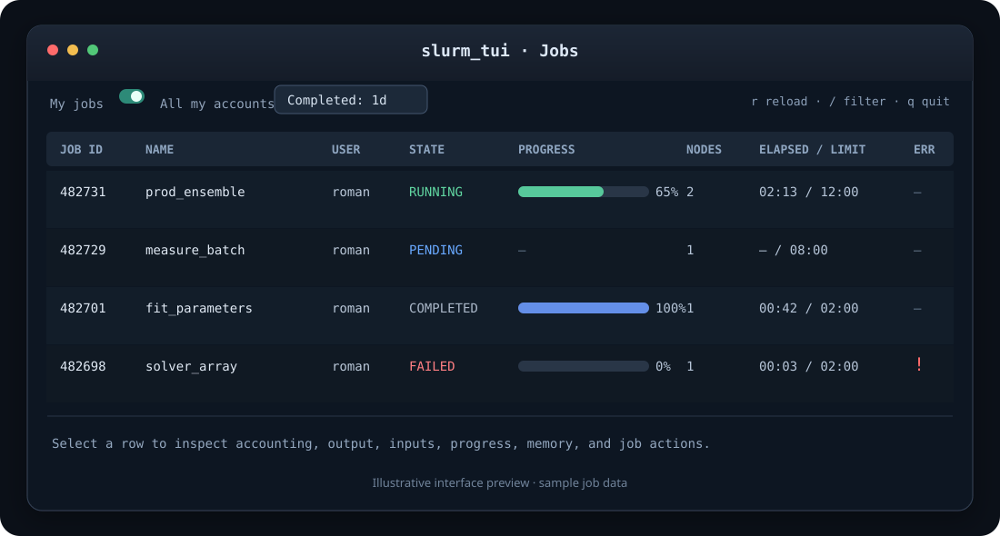

# The job list

Browse queued and running jobs alongside recently completed jobs, sort by
columns (the header marks the sort column with ▲ or ▼; Job ID cycles through job ID
descending and ascending and array index ascending and descending, marked △/▽), and filter by job
name, command, ID, state, user, account, or path. The window of finished jobs is
chosen from a list (only queued, 1 hour … 1 month) or typed (custom …: numbers
with the units `s`, `m`, `h`, `d`, `w`, `mo`, `y`, e.g. `3d12h`); each tab keeps its own. The dropdown next to it selects
whose jobs are listed: yours, those of one of your Slurm accounts, or those of
all of them (the accounts come from `sacctmgr`). Progress appears when the
output contains a line such as `65/100`; two columns estimate when a running job
gets to the end: **Done: current pace** (at the rate of the last few `n/N` lines; `-` until there are two; the
[job window](job-window.md) also estimates it at the average rate since the job started).
The job list, the job window and the array window refresh by themselves every 60 seconds
(`"refresh_seconds"` in the config); **⟳ 0:42** in the title bar counts down to the next refresh, and a
click on it switches automatic refreshing off (**⟳ off**) and on again (kept for the next start).

The list shows as soon as Slurm answers; the command, error file and progress of
each job (files on the cluster) follow, with spinners in those cells for jobs
not seen before (the others keep their values meanwhile). The sizes of the error
files of ended jobs are kept, and asked in one `stat` for many files; the progress
of all running jobs is read by one command that sends back only the `n/N` and `M%` lines. An array with ten or more tasks in the list is
one row (`9600_[1-150] ▸ 150 tasks`) whose state is the mix of its tasks' states
in Slurm's short codes, coloured: `30R 10PD 100CD 10F` (running, pending,
completed, failed; CA cancelled, TO timeout, …); clicking ▸ (or Space) lists
every task under it and closes it again, and **group arrays** (or `g`) switches
between grouped arrays and every task. Enter or a click elsewhere opens the window
of the array: what it is, the node hours of all its tasks together, queue waits and run times (min, avg, median, max),
all its tasks by state (ended ones also by exit code, pending ones by reason)
with their number and ids (a click on an id opens the job window of that task, in a subtab of its own), to copy, a list of every
task with its progress bar (sorted by the header clicked; a click on a task opens its job window, in a subtab of its own), the nodes in use, and buttons to cancel the whole array or only its pending tasks
(after a confirmation). The job window of an array task has an **Array** button
for it.

Without Slurm on the machine of a tab (no `squeue` there, e.g. the Local tab
on your own computer), the job list says so in its middle, with what to do: add
a tab for a cluster with `+`. `r` looks again (after
`module load slurm`, for example); shells, drives and files work without Slurm.

**The list is kept** on this machine after each load (`~/.cache/slurp/joblists/`,
only for you), so it is there when the cluster is not: slurp starts with the
last list of each tab at once, and when the cluster cannot be reached (down,
in maintenance, no network) you can still browse it, open what is kept of a
job, and categorize. The status line then says so: *⚠ the list from 09:12 (the
cluster cannot be reached): it may be outdated*. Changes to the categories
made meanwhile are kept here too and written to the cluster with the next
load (one that no longer fits, e.g. a rename of a category someone deleted
meanwhile, is skipped and named).

## Categories

Put your jobs in **categories**, like folders: `project X/production runs`,
`project X/tests`, `thesis/scaling`. In the job list, `m` marks a row (again:
unmarks it; `M` marks all rows or none), and `c` puts the marked jobs (or the
one under the cursor) in a category: pick one, or type a new path (`a/b` makes
b in a). An array goes in as a whole, with all its tasks; a single task can
have its own. `c` in a job window does the same for that job. The **Category**
column shows where each job is (a click on its header sorts by it), and the
filter finds categories too: `/` with `cat:project X` lists only that category
and the ones in it, `cat:-` the jobs in none.

**Categories** (in the menu, or `K`) shows them as a tree, with how many
jobs each has. For the one selected (with the categories in it) it shows its
numbers: jobs and array tasks, by state, and how many of those that ended
completed; node, CPU and GPU hours (nodes, CPUs and GPUs of Slurm's
accounting, times the run time); from the first submit to the last end; the
partitions and accounts. Below them are its jobs: a click opens one (an array: its window), in a subtab
of its own; **Cancelled because** says why a job was cancelled, as told when cancelling it. slurp
asks Slurm for these jobs themselves (`sacct -j`), so old jobs count too, as
long as Slurm's accounting keeps them; the ones it no longer knows are named.
At the end of the tree, **not categorized** has the jobs of the job list
(queued, and those finished within its *finished since*) that are in no
category, with their numbers: `c` there (or on any job of the window) puts
the job selected in a category.
**New** (`n`), **Rename** (`e`: another path moves it with all it has, into an
existing category they merge), **Delete** (`Del`: its jobs go to the category
it is in), **Categorize…** (`c`) and **Take job out** (`x`) for the marked
jobs or else the one selected (`m` marks a job and moves on, `M` marks all of
them or none, as in the job list), **In the job list** (`l`) and **Reload** (`r`). **Notes…** (`o`)
annotates the category selected in Markdown (what it is for, how its runs
differ, links); the window shows the notes rendered under its numbers, a
rename takes them along.

The categories are kept on the cluster, in `~/.config/slurp/categories.json`
in your home there, so slurp on your own machine and slurp on the login node
see the same. One home is often shared by several clusters (at CSCS: daint,
eiger, …), whose job ids repeat, so the file has one part per Slurm cluster
(its `ClusterName`). slurp reads it with every reload and writes it back with
each change; a file that is not valid JSON is not overwritten (slurp says so).
