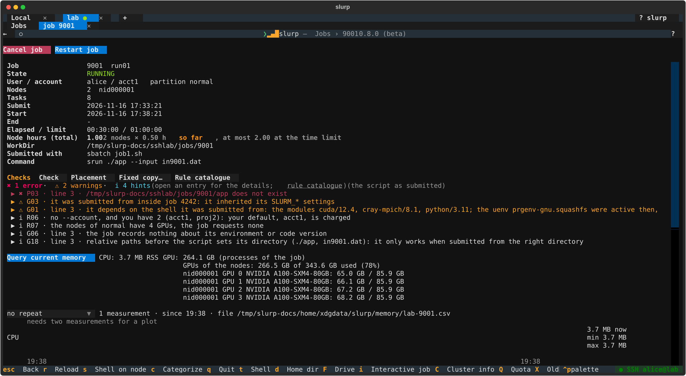

# The job window

Open a row to inspect accounting fields, steps, output and error files, the
batch script, and files referenced by the job. **Node hours (total)** is nodes ×
elapsed time (for a running job so far, with the most it can take by its time limit). **Cancel job** and **Restart
job** ask for confirmation; restart lets you use the original submission,
retry eligible array IDs, or edit a custom command (in a bash editor). If
the cluster keeps them, restart also offers the environment the job was
submitted with (`sacct --env-vars`: uenv, loaded modules, all variables; sbatch
then runs under `env -i` with exactly these, without the old job's `SLURM_*`)
and the batch script as submitted (`scontrol write batch_script` /
`sacct --batch-script`, saved as `.slurp-restart-<job>.sh` next to the job), so
the job runs again as it ran before even if the file on disk changed. For an
array task, **Run array** submits the array again with another range (start,
stop, step) and warns when the range covers tasks that are running, queued or
completed.

The progress shows the latest `n/N` line (or `M%`: a number from 0 to 100,
with or without decimals, in a line without `n/N`), and estimates when the job reaches
`N`: **on same pace** (the average rate since the job started) and **on current
pace** (the rate of the last few `n/N` lines), each with the remaining time and the time of day. The
times are the timestamps of the lines if they have one, else the times slurp
saw a new `n`. A job that ended keeps its progress: the last line of its
progress file (where it got to) and how it ended ("the job ended FAILED (exit
code 1:0) here"). **Progress file…** picks another (log) file for this job, in
the directory browser; **Use stdout** goes back. For a task of an array, the
progress files of the other tasks are guessed from the name of the chosen one:
the index of the task (or its job id) in the name marks the task, other digits
(dates, times) may differ; the newest match is used, and tasks whose file is
not there yet are looked for again at every reload. Only the end of the file is
read (64 kB), every 10 seconds while the job runs (the window shows when it was
last read); a chosen file is also listed among the job's files as `progress`.

For a running job, press **Query current memory** to see the job's memory now,
in binary units (MiB, GiB) as `free -h` and `nvidia-smi` show it:

- **CPU:** the job's cgroup on its nodes, the memory Slurm counts against
  `--mem` and the out-of-memory killer acts on (with how much of it is page
  cache); where there is none, the PSS of its processes (shared memory counted
  once), else their RSS. Then the processes' PSS and RSS, and each node as `free`
  shows it (used = total − available, available, buff/cache): with the node to
  itself the job is most of *used*; other jobs and the system are in it too.
- **GPU:** the memory of the job's processes on the GPUs (`nvidia-smi
  --query-compute-apps`); where the driver does not report it per process
  (`[N/A]`: MIG, some drivers), the used memory of the GPUs the job's processes
  run on. Then every GPU's used and total, the numbers of `nvidia-smi`'s table.
 The query is the script `src/slurp/scripts/memory_probe.sh`,
run on every node of the job as a step (`srun --overlap --input=all … bash -s`)
with the script on stdin, so nothing is copied to the cluster. Every query is
kept: the dropdown next to it repeats it every 1, 5, 15, 30 or 60 minutes (also
while the window is not shown), two sparklines plot CPU and GPU memory over
time (bars from zero, with the largest value and the time span), and the
measurements are appended to
`~/.local/share/slurp/memory/<tab>-<job>.csv`. This query is on demand; the fields are empty until
requested. GPU usage is gathered from the processes of the job reported by
`nvidia-smi` (or `rocm-smi` on AMD nodes), together with the used and total
memory of every GPU of the nodes. Completed and failed jobs show CPU peak memory from Slurm
accounting, and GPU peak memory when the accounting database reports it.

