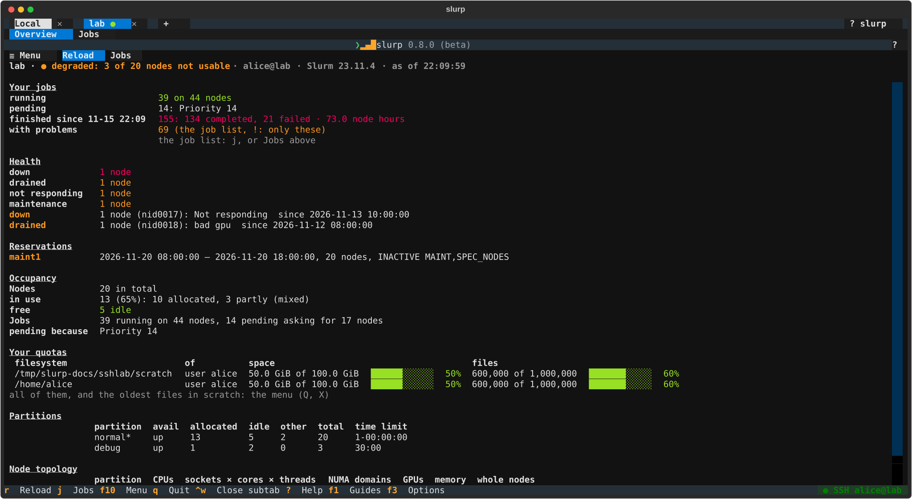

# The overview

While none of its subtabs is open, a tab shows its **overview**: at the start, and when the last subtab closes. In its
middle, a few lines about the cluster and the ways on.

- **The cluster** in a line: the site (when a [rule pack](checks.md) knows it), how slurp reaches it (SSH, or this
  machine), the Slurm version, its nodes and partitions.
- **Its health**: healthy (green), degraded (yellow) or unhealthy (red), and why: nodes down, drained or in
  maintenance, a maintenance soon.
- **The SSH session**, as the status at the bottom right shows it: who you are logged in as and the round trip.
- **Jobs** opens the [job list](job-list.md) as a subtab (`j`); its label says how many of your jobs run and wait.
  Where there is no Slurm, *No Slurm available* stands there instead.
- **Quota** (`Q`) and **Health** (`C`: health with the reasons, reservations, occupancy, partitions, node
  topology) open as windows over the overview (`Esc` closes them).
- For a known site, its status page and documentation (a click opens them).

Not connected, the overview shows **Connect** in its middle, with what happened to the connection (never connected,
closed, lost and why); while logging in, the login is in the pane on the right. slurp does not log in by itself at the
start: a cluster tab waits for Connect (a tab added with `+` logs in right away). Connected, **Disconnect** ends the
session. Below it, for a tab of a cluster, **SSH settings…** shows how the tab logs in:
its destination, or its full SSH settings (host, user, port, jump hosts, identity
files, more options), the blocks of your `~/.ssh/config` that apply (with file and
line) and what ssh makes of it all (`ssh -G`), with **Check** (as when adding a
tab). **Save** changes the tab; the next login uses it (**Reconnect**).

The cluster is asked in the background when the overview is shown, and again after 5 minutes; `r` asks at once.
To have the job list open from the start: **Options** (`F3`), *At the start a tab shows*: its job list
(`"start_page": "jobs"` in the [settings](settings.md)).
