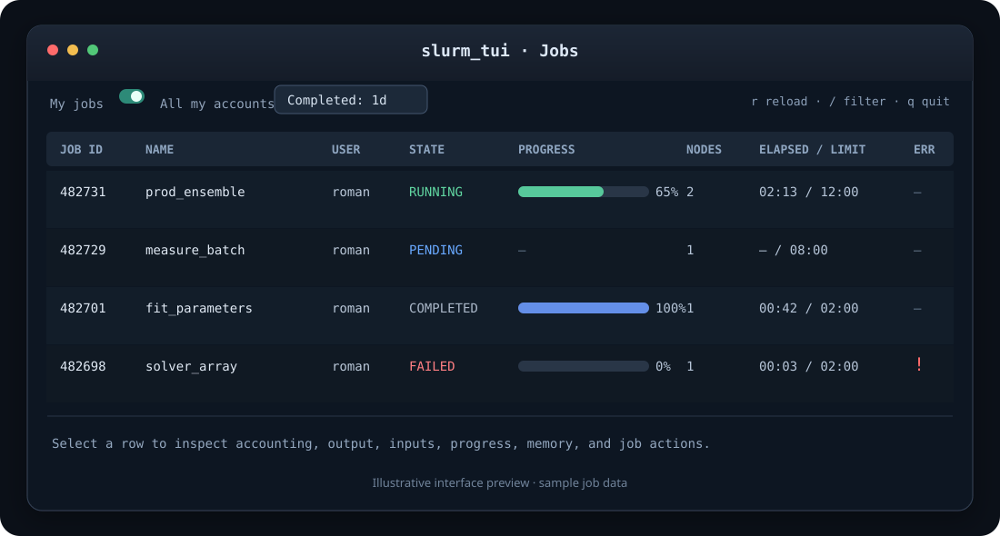

<p align="center"></p>

# slurp

`slurp` is a Textual interface for checking Slurm jobs and inspecting the files and resources associated with them:
queued, running and finished jobs, their output and scripts, the nodes they run on, checks of batch scripts against a
rule catalogue, and shells and drives on the cluster. It runs on a host with access to your Slurm commands,
configuration and job files, or on your own machine with an SSH connection to one. Use it in a terminal or in a
browser.



```bash
python -m pip install "slurp[all] @ git+https://github.com/chaoos/slurp"
slurp                         # on a login node, or on your own machine
                              # (+ adds a tab for a cluster over SSH)
```

More in [Install and start](install.md).

## What it does

<div class="grid cards" markdown>

- **[The overview](guide/overview.md)**: what a tab shows while nothing is open in it: the cluster, its health and
  the SSH session in a few lines, with the way to its jobs, quota and health; Connect when not connected.
- **[The job list](guide/job-list.md)**: queued, running and finished jobs; progress and when a job will be done;
  arrays as one row; categories like folders; the last list kept for when the cluster is down.
- **[The job window](guide/job-window.md)**: accounting, steps, files; cancel, restart (with the environment it was
  submitted with), run an array again; the memory of a running job on its CPUs and GPUs.
- **[Files and node tools](guide/files.md)**: output that follows a running job, Markdown, HDF5 read in place, core
  dumps with GDB; commands and shells on the nodes of a job.
- **[Checks](guide/checks.md)**: batch scripts and jobs against a catalogue of rules, from beginner mistakes to NUMA
  placement, each with why and how to fix it; a script view that checks as you type.
- **[Clusters over SSH](guide/ssh.md)**: one SSH session per cluster for everything, with its health, reconnects and
  the status page of the site.
- **[From your own machine](remote/links.md)**: a shell or a drive of the cluster on your laptop through a relay, with
  the [slurp helper](remote/helper.md) in one click; [this slurp in your browser](remote/web-access.md), from anywhere.

</div>

In the app, the `?` key (or the **?** button of a window) explains the window shown, `F1` opens the guides (job
scripts, arrays, filesystems, GPUs, …) and `F2` the rule catalogue.

**Version**: `slurp --version`; the header of the app shows it too. slurp is in beta: settings, link formats and the
helper may still change between versions. What changed: the [changelog](changelog.md).

The pictures are screenshots of slurp against the lab of its tests, a fake Slurm cluster with sample jobs and files
(see [Development](development.md)).
