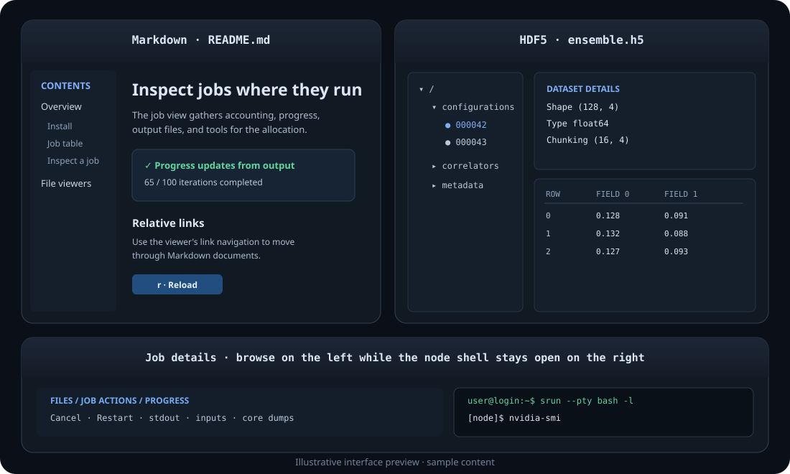

# slurp

`slurp` is a Textual interface for checking Slurm jobs and inspecting
the files and resources associated with them. It is designed to run on a host
with access to your Slurm commands, configuration, and job files. You can use
it in a terminal or open it in a browser.

The images below are illustrative previews built from the app's current
features and sample data; they are not screenshots from a live cluster.

## Job list

Browse queued and running jobs alongside recently completed jobs, sort by
columns (the header marks the sort column with ▲ or ▼; Job ID cycles through job ID
descending and ascending and array index ascending and descending, marked △/▽), and filter by job
name, command, ID, state, user, account, or path. The window of finished jobs is
chosen from a list (only queued, 1 hour … 1 month) or typed (custom …, same
duration syntax as `slurm.py -c`, e.g. `3d12h`); each tab keeps its own. The dropdown next to it selects
whose jobs are listed: yours, those of one of your Slurm accounts, or those of
all of them (the accounts come from `sacctmgr`). Progress appears when the
output contains a line such as `65/100`; two columns estimate when a running job
gets to the end: **Done: same pace** (at the average rate since the job started)
and **Done: current pace** (at the rate of the last few `n/N` lines; `-` until there are two). An array with ten or more tasks in the list is
one row (`9600_[1-150] ▸ 150 tasks`) whose state is the mix of its tasks' states
in Slurm's short codes, coloured: `30R 10PD 100CD 10F` (running, pending,
completed, failed; CA cancelled, TO timeout, …); clicking ▸ (or Space) lists
every task under it and closes it again, and **group arrays** (or `g`) switches
between grouped arrays and every task. Enter or a click elsewhere opens the window
of the array: what it is, the node hours of all its tasks together, queue waits and run times (min, avg, median, max),
all its tasks by state (ended ones also by exit code, pending ones by reason)
with their number and ids, to copy, a list of every task (a click opens its job
window), the nodes in use, and buttons to cancel the whole array or only its pending tasks
(after a confirmation). The job window of an array task has an **Array** button
for it.


## Job details and controls

Open a row to inspect accounting fields, steps, output and error files, the
batch script, and files referenced by the job. **Node hours (total)** is nodes ×
elapsed time (for a running job so far, with the most it can take by its time limit). **Cancel job** and **Restart
job** ask for confirmation; restart lets you use the original submission,
retry eligible array IDs, or edit a custom command (in a bash editor). If
the cluster keeps them, restart also offers the environment the job was
submitted with (`sacct --env-vars`: uenv, loaded modules, all variables; sbatch
then runs under `env -i` with exactly these, without the old job's `SLURM_*`)
and the batch script as submitted (`scontrol write batch_script` /
`sacct --batch-script`, saved as `.slurp-restart-<job>.sh` next to the job), so
the job runs again as it ran before even if the file on disk changed. For an
array task, **Run array** submits the array again with another range (start,
stop, step) and warns when the range covers tasks that are running, queued or
completed.

The progress shows the latest `n/N` line, and estimates when the job reaches
`N`: **on same pace** (the average rate since the job started) and **on current
pace** (the rate of the last few `n/N` lines), each with the remaining time and the time of day. The
times are the timestamps of the lines if they have one, else the times slurp
saw a new `n`. **Progress file…** picks another (log) file for this job, in
the directory browser; **Use stdout** goes back. For a task of an array, the
progress files of the other tasks are guessed from the name of the chosen one:
the index of the task (or its job id) in the name marks the task, other digits
(dates, times) may differ; the newest match is used, and tasks whose file is
not there yet are looked for again at every reload. Only the end of the file is
read (64 kB), every 10 seconds while the job runs (the window shows when it was
last read); a chosen file is also listed among the job's files as `progress`.

For a running job, press **Query current memory** to request current CPU RSS
and GPU process memory. The query is the script `slurp/scripts/memory_probe.sh`,
run on every node of the job as a step (`srun --overlap --input=all … bash -s`)
with the script on stdin, so nothing is copied to the cluster. Every query is
kept: the dropdown next to it repeats it every 1, 5, 15, 30 or 60 minutes (also
while the window is not shown), two sparklines plot CPU and GPU memory over
time (bars from zero, with the largest value and the time span), and the
measurements are appended to
`~/.local/share/slurp/memory/<tab>-<job>.csv`. This query is on demand; the fields are empty until
requested. GPU usage is gathered from the processes of the job reported by
`nvidia-smi` (or `rocm-smi` on AMD nodes), together with the used and total
memory of every GPU of the nodes. Completed and failed jobs show CPU peak memory from Slurm
accounting, and GPU peak memory when the accounting database reports it.


## Files and node tools

The file browser opens from the job details and lets you move through the
working directory and related paths. It includes specialized views:

- **Markdown:** `.md`, `.markdown`, `.mdown`, and `.mdx` files render with
  Textual's `MarkdownViewer`, including a table of contents and link navigation.
- **HDF5:** browse groups, datasets, attributes, and paged data; a string
  dataset named `*.md` is rendered as Markdown. HDF5 files
  are recognized by their file signature, including files without an `.h5`
  extension.
- **Core dumps:** inspect ELF core metadata with GDB and edit the suggested GDB
  command before launching it in the terminal pane. Core-to-job association
  uses node and timestamp clues and is marked as likely/possible.
- **Text and output:** follow running stdout/stderr, search text, and open
  paths or line references found in file contents.

For a running job, run commands such as `nvidia-smi`, `free`, `top`, or `ps`
on its allocated nodes. Shells on its node and GDB sessions open as subtabs.

## Tabs and subtabs

Every tab is a cluster (or this machine). Under the tabs, each tab has its
subtabs: **Jobs** (the job list, always there), and one subtab with a `✕` for
each job window, each file or directory opened from the job list, and each
shell (on the cluster, on the node of a job, GDB). What you open inside a
subtab, like the files of a job, opens in that subtab; `←` or `Esc` goes back,
and back from its first window shows the job list. Opening a job again shows
its subtab. Switching tabs keeps the subtabs. In a shell all keys go to the
shell, except `Ctrl-]`, which goes back to the job list; `Ctrl-W` closes the
subtab shown (outside a shell). Every tab can be closed, also the last one;
then only the `+` button remains.



## Install and launch

Run the program from this repository on a login or other host with Slurm
access. The package directory `slurp/` must stay next to `slurm.py` (and the
modules it uses) in this repository.
Create and activate a virtual environment, then install the repository's
Python dependencies:

```bash
python3 -m venv .venv
source .venv/bin/activate
python -m pip install -r requirements.txt
```

The requirements file includes the dependencies used by the repository's
scripts, plus the Textual app's terminal and browser features. System commands
such as `ssh`, `squeue`, `sacct`, `scontrol`, `srun`, and `sbatch` are installed
separately and must be available locally or on the selected SSH host.

The standalone `fzip.py` compression utility also uses the legacy `bitstream`
package, whose source build fails under pip's isolated build environment. It is
not needed by slurp. If you use `fzip.py`, install it separately with:

```bash
python -m pip install --no-build-isolation bitstream
```

`h5py` enables the HDF5 browser. If it is unavailable, the app can show
`h5dump -H` output when `h5dump` is installed.

Start the terminal UI from the repository:

```bash
python3 slurp          # or: python3 -m slurp
```

Use `--log FILE` to log Slurm commands and debug events. The app has no
required configuration file; job and file selection happens inside the UI.

## Connect to Slurm over SSH

The Textual app stays on your local machine. It starts with a **Local** tab.
Pass one or more regular OpenSSH destinations (`user@host`) or aliases from
your `~/.ssh/config` to add tabs:

```bash
python3 slurp --ssh localhost user@host cluster-login
```

OpenSSH uses your configured identities, certificates, agent, host aliases,
and `ProxyJump` chain. `localhost`, `127.0.0.1`, and `::1` refer to the local
machine tab.

Each remote tab has one SSH session, opened the first time you select the
tab and held open for the life of the app. The login runs in the terminal
pane on the right, where password, key passphrase, keyboard-interactive, and
OTP prompts are answered. Once you are logged in, the pane hides by itself
and the job list loads; nothing has to be typed after the login. A failed
login stays in the pane so the error can be read; Enter there logs in again,
and closing it (`✕`) gives up the connection.

The session runs a shell on the cluster that the app sends its commands to:
a reload (or opening a file, a directory, the job details) only sends lines
into the open session and costs a round trip; no ssh process is started for
it. Several commands can run at the same time, so a slow `sacct` does not hold
up browsing, and aborting one stops only that command. The login scripts of
the cluster run once, when the session starts, and what they print is
ignored. Interactive shells (Shell, node shells, GDB) open as extra channels
of the same connection, without a new login. Files are never copied: text
files are read in parts (the last 1 MB, `A` for the part before, following
reads only what was appended), and HDF5 files are read in place by h5py
through a file object that fetches only the byte ranges it asks for (1 MiB
blocks), so a large file costs only what is browsed.

Clicking the connection state in the footer opens the connection
window of the tab: its state, the course of a (re)connect (connecting,
waiting for input, connected, failed with the error and what ssh printed), the
logged-in user and login node, the resolved destination (`ssh -G`), traffic
and round-trip times of the command channel, the ssh process and its TCP
connection (bytes, rtt, retransmissions, from `ss`), and a log of the session
events. **Reconnect** ends the session and logs in again, **Disconnect** ends
it until the tab is selected again.

The footer shows the state of the session of the active tab, tinted by its
health: green (answers, with the round-trip time), yellow (slow, connecting),
red (no answer, lost); the connection window shows the same in its title and the tab buttons mark each tab: `●`
connected, `◌` connecting or not answering, `○` not connected. A heartbeat
notices a session that stops answering ("no answer for …" in the footer);
after 60 seconds without an answer, or when the session breaks, the app
reconnects by itself right away, and if that fails again after 5, 15, 30
and then every 60 seconds. If
the login needs a password, the pane appears for it. Commands that were
waiting, like a reload, go on once the session is back; a cancel or restart
of a job is never sent twice. The UI does not wait for the cluster at any
point: all commands and remote file access run in the background.

The remote host needs Slurm commands, a POSIX shell, and standard Linux file
tools; it does not need Python, a copy of this repository, or Textual
installed.

Each tab keeps its own job list, shell, and session. Switching tabs shows the
list as it was loaded; `r` (or **Reload**) loads it again. While a list
loads, the old one stays visible, the footer shows the progress, and `a` (or
the **Abort** button, which replaces **Reload** meanwhile) stops it.
**Shell** (or `t`) opens a login shell on the cluster of the tab in a subtab. The **+** tab button adds another local or remote connection.
`d` opens the login directory in the directory browser. Each tab has a `✕`
that closes it (after asking). Notifications name the tab they belong to.

**Interactive job** (or `i`) shows an `sbatch` command for a job that only
holds a node (`sleep infinity`) in a bash editor, with fields for the account
(one of yours or typed), the partition, the time limit, nodes, GPUs and the job
name; the fields write the command, which stays editable. Once the job runs, its job
window opens shells on its node. **Cluster info** (or `C`) shows the health
of the cluster (nodes down, drained, in maintenance, not responding, with
the reasons; reservations), its occupancy (busy and idle nodes, running and
pending jobs and why they wait) and the partitions, with its own Reload; its
title says healthy (green), degraded (yellow) or unhealthy (red) and why;
without a connection it says so, with Reconnect.

## Copying

Copy buttons send the text to the terminal (OSC 52, wrapped for tmux and GNU
screen) and put it on the clipboard with the tool of the machine slurp runs on
(`wl-copy`, `xclip`, `xsel`, `pbcopy`; over SSH only a forwarded display counts).
OSC 52 is the only way to your clipboard when you ssh to the machine slurp runs
on, and only some terminals take it (kitty, WezTerm, iTerm2, Alacritty, foot,
Windows Terminal; in tmux with `set -g set-clipboard on`; not GNOME Terminal or
Konsole). Without a tool a window says so and offers **Plain text** (slurp steps
aside and prints the text in the normal screen, where the terminal's own mouse
selection works; Enter comes back), **Save to a file** (`~/.cache/slurp/copied.txt`)
and **It arrived, don't ask again** (stored as `"copy": "terminal"` in the
settings; remove it to get the window again).

## Settings

slurp keeps a few settings in `~/.config/slurp/config.json` (or under
`$XDG_CONFIG_HOME`): the theme (chosen with the command palette, `Ctrl-P`), the
open tabs with the one shown and their choices (finished since, accounts),
the progress files chosen for jobs and the patterns for arrays. At the next
start the tabs are back, and the tab shown connects; the others connect when
they are selected. The dot of an SSH tab is coloured by the health of its
session (green, yellow, red; grey when not connected yet).

## Storage: quota and old files in scratch

**Quota** (or `Q`, a subtab that loads in the background) lists your quotas, and those of your groups where they
use space or have a limit: `lfs quota` on each Lustre filesystem and on
`$SCRATCH`, `$HOME`, `$PROJECT`, `$STORE`, `$WORK`, `quota` on the others,
with space and files (inodes), used, limit and soft limit, and a bar coloured
by how full it is. The output of a site's own `quota` command is shown too.

Scratch filesystems are usually cleaned up automatically: files not used for
some time are deleted without asking. **Scratch** (or `X`) searches your files
in `$SCRATCH` in the background (one `find` on the cluster; it can be
aborted) and lists the 2000 with the oldest access (or modification) time;
those older than the given number of days (30) are red, those in its last fifth
yellow. An exclude regex leaves matching paths out of the list and of every
touch. **Touch selected**,
**Touch all listed** and **Touch all my files there** set their access time
to now (after a confirmation). Mind that many sites do not allow keeping files
in scratch this way; move what you need to keep elsewhere.

## Browser access

### Local browser or SSH tunnel

Install `textual-serve` in the same Python environment and start the local
browser server:

```bash
python -m pip install textual-serve
python3 slurp --serve
```

Open <http://localhost:8000>. The server binds to `127.0.0.1` by default;
`--host` and `--port` change the bind address and port. To access it through
two SSH proxies, run the server on the Slurm host and forward the port:

```bash
ssh -J user@jump1,user@jump2 -N \
  -L 8000:127.0.0.1:8000 user@slurm-login
```

Then browse to <http://localhost:8000> on your computer. Substitute your SSH
hostnames and usernames. If local port 8000 is occupied, use a different local
port, e.g. `-L 18000:127.0.0.1:8000`, and open `http://localhost:18000`.

### Random public link with Textual Web

If the Slurm host can make outbound internet connections, Textual Web can
relay a Textual app to a random public URL without an inbound port or SSH
forward. Install `textual-web`, then create a configuration file such as
`serve.toml`:

```toml
[app.Slurm]
command = "cd /path/to/scripts && /path/to/venv/bin/python slurp"
```

Run it from the project directory:

```bash
textual-web --config serve.toml
```

Textual Web prints a random URL that can be opened from a browser on another
network. Its documentation currently describes the project as beta. Anyone
with the URL can access the running app, so treat it as a secret bearer link:
the app can run Slurm actions and launch shells as the account running it.
Use this only when that access is appropriate. A permanent account URL is
available in Textual Web, but it is an address and should not be treated as a
secret. See the [Textual Web project](https://github.com/Textualize/textual-web)
for its current setup and access behavior.

Install Textual Web separately with `python -m pip install textual-web`.
Terminal suspension is unavailable in browser mode, so opening a file in
`less` is a terminal-only action.

## Keyboard and mouse

The app supports clicking and scrolling as well as keyboard navigation. Use
`Tab` to move between controls, `Enter` to open a selection, and `Esc` or the
top-left `←` button to go back.

| Screen | Main controls |
|---|---|
| Job list | `/` search jobs; `Enter` open; `Space` open/close an array row; `g` group arrays on/off; `r` reload; `a` abort loading; `t` shell on the cluster; `d` login directory; `i` interactive job; `C` cluster info; `Q` quota; `X` old scratch files; `q` quit |
| Job details | `Cancel job` / `Restart job` / `Run array` / `Array`; `r` reload; `s` shell on the node (subtab) |
| Text file | `/` search; `n` / `N` next/previous; `f` follow; `A` the part before; `l` open in `less`; `r` reload |
| Directory | `/` filter; `f` follow; `.` toggle hidden files; `Backspace` or `u` go to parent |
| HDF5 | `s` enter a dataset selection; `[` / `]` change row page (200 rows); `{` / `}` change column page; `r` reload |
| Markdown | `r` reload; use the viewer's table of contents and link navigation |
| Shell (subtab) | `Ctrl-]` back to the job list; `Ctrl-D` exits the shell, Enter starts it again; `✕` of the subtab closes it |
| Subtabs | `Ctrl-W` close the subtab shown (outside a shell) |
| Login pane | `Ctrl-]` switch between the window and the login; `Ctrl-X` gives up the login |

When using tmux, enable mouse support with `set -g mouse on` if you want to
click and scroll inside the app.
